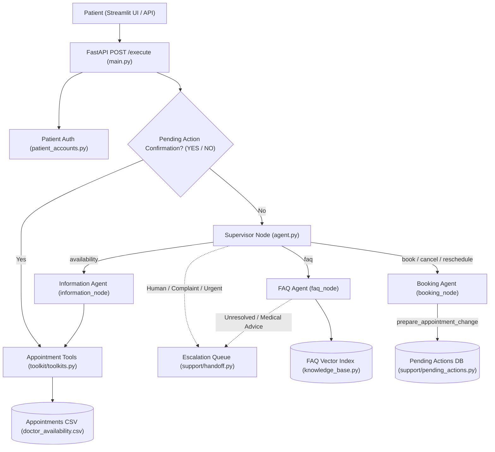

# Clinic AI Customer Service

An AI multi-agent system for clinic customer service and appointment management built with **LangGraph**, **FastAPI**, **Streamlit**, **SQLAlchemy**, and **OpenAI**. It answers clinic FAQs using semantic search (RAG) and manages doctor appointments (check availability, book, cancel, reschedule) through validated tools and a `YES`/`NO` confirmation gate.

---

## 1. Agents in the System (`agent.py`)

| Agent / Node | Role & Tools |
| :--- | :--- |
| **Supervisor (`supervisor_node`)** | Entry point that checks for escalation triggers and classifies the user's intent (`faq`, `availability`, `book`, `cancel`, `reschedule`, or `fallback`) to route the request to the right specialist. |
| **FAQ Agent (`faq_node`)** | Searches approved clinic FAQs via OpenAI embeddings and a local vector index (`knowledge_base.py`). Refuses medical-advice requests and escalates unanswered questions. |
| **Information Agent (`information_node`)** | ReAct agent that checks available appointment slots using `check_availability_by_doctor` and `check_availability_by_specialization` (`toolkit/toolkits.py`). |
| **Booking Agent (`booking_node`)** | ReAct agent that validates booking, cancellation, and rescheduling details and stages a pending proposal via `prepare_appointment_change` (`support/pending_actions.py`). |
| **Escalation Handler (`escalation_node`)** | Triggered on human-agent requests, complaints, urgent symptoms, or unresolved FAQs; records a redacted support case in SQLite (`support/handoff.py`). |

> **Confirmation Gate:** The Booking Agent never modifies the schedule directly. FastAPI (`main.py`) executes `set_appointment`, `cancel_appointment`, or `reschedule_appointment` only after the patient replies with an exact `YES` (or `نعم` / `أيوه`).

---

## 2. Architecture & Project Structure



```text
doctor-appoitment-multiagent/
├── main.py                    # FastAPI app, patient auth routes, confirmation gate, and /execute
├── agent.py                   # LangGraph workflow (Supervisor, FAQ, Information, Booking nodes)
├── streamlit_ui.py            # Streamlit chat interface (English & Arabic registration, login, chat)
├── ui_helpers.py              # Validation and message formatting helpers for Streamlit
├── patient_accounts.py        # SQLAlchemy models and bearer session authentication
├── knowledge_base.py          # Semantic FAQ retrieval (OpenAI embeddings + local vector index)
├── prompt_library/prompt.py   # System prompt and routing rules for the Supervisor
├── toolkit/toolkits.py        # CSV availability lookup, booking, cancellation, and rescheduling tools
├── support/
│   ├── pending_actions.py     # SQLite store for staged appointment changes awaiting YES/NO
│   └── handoff.py             # SQLite queue for human support escalation
├── data_models/models.py      # Pydantic models for dates (DD-MM-YYYY HH:MM) and patient IDs
├── utils/
│   ├── llms.py                # OpenAI model loader with timeout and retry configuration
│   └── session.py             # SHA-256 thread ID generator for conversation memory
├── data/                      # Default FAQ JSON and appointment schedule CSV
├── deployment/                # Synthetic demo data and prepare_demo_data.ps1 script
├── tests/                     # Automated Pytest suite
├── Dockerfile                 # Non-root Python 3.12 container image
├── docker-compose.yml         # Multi-container setup (PostgreSQL + FastAPI + Streamlit)
└── requirements-runtime.txt   # Pinned runtime dependencies
```

---

## 3. How to Run It

### 1. Install Dependencies

```powershell
python -m venv .venv
.\.venv\Scripts\Activate.ps1
python -m pip install --upgrade pip
python -m pip install -r requirements-runtime.txt
```

### 2. Prepare Demo Data & `.env`

```powershell
.\deployment\prepare_demo_data.ps1
# Type DEMO-ONLY when prompted

Copy-Item .env.example .env
```

Update `.env` with your keys and local paths:

```dotenv
OPENAI_API_KEY=your_openai_api_key
API_ACCESS_TOKEN=your_random_secret_token
PATIENT_DATABASE_URL=sqlite:///./runtime-data/patient_accounts.sqlite3
APPOINTMENT_CSV_PATH=runtime-data/doctor_availability.csv
CLINIC_FAQ_PATH=runtime-data/clinic_faq.json
FAQ_RAG_INDEX_PATH=runtime-data/faq_index
```

### 3. Start the Application

**Run Locally (Two Terminals):**

```powershell
# Terminal 1 — FastAPI Backend (http://127.0.0.1:8003)
uvicorn main:app --host 127.0.0.1 --port 8003 --reload

# Terminal 2 — Streamlit UI (http://127.0.0.1:8501)
streamlit run streamlit_ui.py
```

**Or Run with Docker Compose:**

```powershell
docker compose up --build
```
