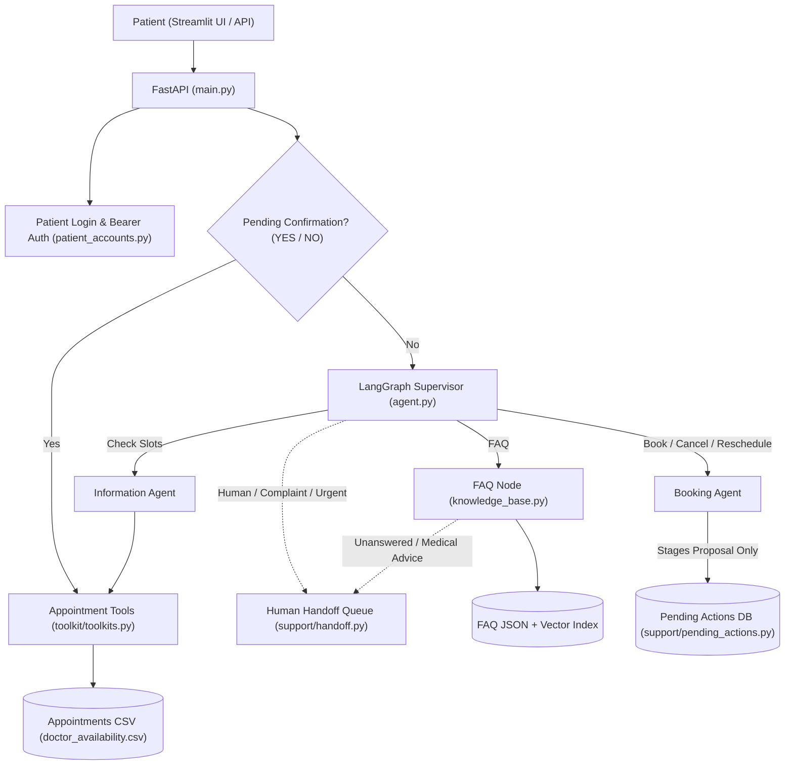

# Clinic AI Customer Service

An AI-powered clinic assistant for answering patient FAQs and managing doctor appointments (check availability, book, cancel, reschedule) using **LangGraph**, **FastAPI**, **Streamlit**, **SQLAlchemy**, and **OpenAI**.

---

## 1. How It Works

The system separates **informational questions (RAG)** from **appointment actions (tools)** so the AI never invents clinic policies or changes appointments without confirmation:



1. **Patient Onboarding & Auth:** New patients register (`POST /patients/register`), get approved by clinic staff (`POST /staff/registrations/{id}/approve`) to receive an 8-digit `patient_id`, and sign in (`POST /patients/login`).
2. **Supervisor Routing:** Every message goes to the LangGraph `supervisor`, which routes it to the right specialist:
   - **`faq_node`:** Searches approved clinic FAQs using OpenAI embeddings (`knowledge_base.py`). Refuses medical advice and escalates unknown questions.
   - **`information_node`:** Checks available slots by doctor or specialty (`toolkit/toolkits.py`).
   - **`booking_node`:** Validates booking, cancellation, or rescheduling requests and stages a pending proposal (`prepare_appointment_change`) without modifying the schedule.
3. **Safe Confirmation Gate:** The schedule is only updated when the patient replies with an exact standalone `YES` (or `نعم` / `أيوه`) in the next turn, or cancelled if they reply `NO` (or `لا`).
4. **Human Escalation:** Requests for a human agent, complaints, urgent symptoms, or unanswered FAQs are saved to a local SQLite support queue (`support/handoff.py`) with a tracking case ID.

---

## 2. Project Structure

```text
doctor-appoitment-multiagent/
├── main.py                  # FastAPI backend, auth routes, health checks, and /execute endpoint
├── agent.py                 # LangGraph workflow (Supervisor, FAQ, Information, and Booking nodes)
├── streamlit_ui.py          # CareDesk Streamlit web UI (English & Arabic registration, login, and chat)
├── ui_helpers.py            # Input validation and response formatting helpers for the UI
├── patient_accounts.py      # SQLAlchemy models & auth logic for patient accounts and sessions
├── knowledge_base.py        # Semantic FAQ retrieval (OpenAI embeddings + local vector index)
├── prompt_library/
│   └── prompt.py            # System prompt and routing rules for the Supervisor
├── toolkit/
│   └── toolkits.py          # CSV appointment lookup, booking, cancellation, and rescheduling tools
├── support/
│   ├── pending_actions.py   # SQLite store for staged appointment changes awaiting YES/NO confirmation
│   └── handoff.py           # SQLite queue for human support escalation and PII redaction
├── data_models/
│   └── models.py            # Pydantic validators for dates (DD-MM-YYYY HH:MM) and patient IDs
├── utils/
│   ├── llms.py              # OpenAI model initialization with timeout and retry bounds
│   └── session.py           # SHA-256 hashing for patient/session conversation threads
├── data/
│   ├── clinic_faq.json      # Clinic FAQ file (empty [] by default until filled with clinic data)
│   └── doctor_availability.csv # Default sample appointment schedule CSV
├── deployment/
│   ├── prepare_demo_data.ps1 # PowerShell script to copy synthetic demo data into runtime-data/
│   └── demo_data/           # Ready-to-use synthetic bilingual FAQs and 2026 appointment slots
├── docs/                    # Detailed operational guides (RAG, Memory, Escalation, CI/CD, Roadmaps)
├── tests/                   # 130 automated Pytest tests (API, agents, RAG, tools, auth, UI)
├── Dockerfile               # Non-root Python 3.12 container image
├── docker-compose.yml       # Full stack: PostgreSQL (db) + FastAPI (api) + Streamlit (ui)
└── requirements-runtime.txt # Pinned runtime dependencies
```

---

## 3. Quick Start (How to Run It)

### Step 1: Install Dependencies

```powershell
python -m venv .venv
.\.venv\Scripts\Activate.ps1
python -m pip install --upgrade pip
python -m pip install -r requirements-runtime.txt
python -m pip install -r requirements-test.txt
```

### Step 2: Prepare Demo Data & Environment

Copy the synthetic demo files (26 English/Arabic FAQs + 18 sample appointment slots) into `runtime-data/`:

```powershell
.\deployment\prepare_demo_data.ps1
# Type DEMO-ONLY when prompted
```

Create your `.env` file from `.env.example`:

```powershell
Copy-Item .env.example .env
```

Set these core values in `.env` for local execution:

```dotenv
OPENAI_API_KEY=your_openai_api_key
API_ACCESS_TOKEN=your_random_secret_token
STAFF_REVIEW_TOKEN=your_staff_secret_token
PATIENT_DATABASE_URL=sqlite:///./runtime-data/patient_accounts.sqlite3
APPOINTMENT_CSV_PATH=runtime-data/doctor_availability.csv
CLINIC_FAQ_PATH=runtime-data/clinic_faq.json
FAQ_RAG_INDEX_PATH=runtime-data/faq_index
```

### Step 3: Run the Backend & Frontend

**Option A — Run Locally (Two Terminals):**

```powershell
# Terminal 1: Start FastAPI Backend (http://127.0.0.1:8003)
uvicorn main:app --host 127.0.0.1 --port 8003 --reload

# Terminal 2: Start Streamlit UI (http://127.0.0.1:8501)
streamlit run streamlit_ui.py
```

**Option B — Run with Docker Compose (PostgreSQL + API + UI):**

```powershell
docker compose up --build
```

---

## 4. How to Use & Benefit from the Project

### 1. Using the Chat Interface (`http://127.0.0.1:8501`)
1. **Register:** Open the **Create account** tab in Streamlit and submit a name, email, and password (`>= 12` chars).
2. **Approve the Account (Staff Step):** Approve the pending registration using the staff endpoint so the system issues an 8-digit `patient_id`:
   ```powershell
   # Check pending accounts
   Invoke-RestMethod -Method Get -Uri "http://127.0.0.1:8003/staff/pending-registrations" `
     -Headers @{"X-Staff-Review-Key" = "your_staff_secret_token"}

   # Approve account_id = 1
   Invoke-RestMethod -Method Post -Uri "http://127.0.0.1:8003/staff/registrations/1/approve" `
     -Headers @{"X-Staff-Review-Key" = "your_staff_secret_token"}
   ```
3. **Sign In & Chat:** Log in under the **Sign in** tab and start chatting:
   - *Ask FAQs:* `"What are your opening hours?"`
   - *Check availability:* `"Is Dr John Doe available on 12-10-2026?"`
   - *Book/Cancel/Reschedule:* `"Book an appointment with Dr John Doe on 12-10-2026 at 09:00"` -> then reply `YES` (or `نعم`) to confirm.

### 2. Using the REST API Directly (`http://127.0.0.1:8003`)

| Endpoint | Method | Purpose |
| :--- | :--- | :--- |
| `/health/live` & `/health/ready` | `GET` | Liveness and readiness health checks |
| `/patients/register` | `POST` | Register a new patient account (`pending_review`) |
| `/staff/pending-registrations` | `GET` | List accounts awaiting staff approval (`X-Staff-Review-Key`) |
| `/staff/registrations/{id}/approve` | `POST` | Approve account and generate 8-digit `patient_id` (`X-Staff-Review-Key`) |
| `/patients/login` | `POST` | Authenticate and get a 12-hour `Bearer` token |
| `/patients/me` & `/patients/logout` | `GET` / `POST` | View active patient profile or revoke session token |
| `/execute` | `POST` | Send chat messages or `YES`/`NO` confirmations (`X-API-Key` + `Bearer` token) |

*(Note: For quick local testing of `/execute` without patient login, set `PATIENT_AUTH_REQUIRED=false` in `.env`.)*

### 3. Customizing for Your Own Clinic
- **Custom FAQs:** Add your clinic's Q&A items to a JSON file following `deployment/clinic_faq.example.json`, point `CLINIC_FAQ_PATH` to it, and build the embedding index:
  ```powershell
  python -m knowledge_base --source data/clinic_faq.json --index-dir data/faq_index
  ```
- **Custom Doctors & Schedule:** Update the schedule in `APPOINTMENT_CSV_PATH` (columns: `date_slot,specialization,doctor_name,is_available,patient_to_attend`) and update the allowed doctor/specialty lists in `toolkit/toolkits.py` and `support/pending_actions.py`.

---

## 5. Running Tests

Run the full offline test suite (130 tests) without needing an active OpenAI connection:

```powershell
.\.venv\Scripts\python.exe -m pytest -q -p no:cacheprovider
```
